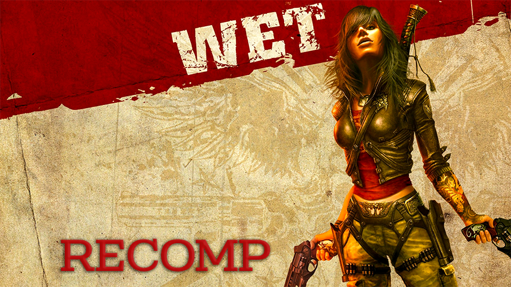

# WetRecomp

<div align="center">
  
</div>

A static recompilation of [**WET**](https://en.wikipedia.org/wiki/Wet_(video_game)) (2009, Xbox 360, Title ID `425307DB`) to native Windows/Linux x86-64, built on the [ReXGlue SDK](https://github.com/rexglue/rexglue-sdk).

## Status

Fully playable: video, audio, gameplay, achievements, and progression all work.

## Requirements

- CMake 3.25+, Ninja, Clang/LLVM (clang-cl works too)
- [extract-xiso](https://github.com/XboxDev/extract-xiso/releases) and your own legally-owned copy of WET:
  Title ID `425307DB` (disc XA-2498), Media ID `3077A693`, Module hash `9A084828F85F951B`

## Game data

Extract the Xbox 360 ISO with `extract-xiso.exe -x WET.iso`, then copy the contents into `assets/` (gitignored):

```
assets/
  default.xex
  nxeart
  lu0/  lu1/
  media/  movies0/  movies1/
  streams0/  streams1/
```

## Build

```bash
git clone --recurse-submodules <repo-url>
```

The ReXGlue SDK is built from the `thirdparty/rexglue-sdk` submodule; no prebuilt SDK is needed.

```powershell
cmake --preset win-amd64-relwithdebinfo
cmake --build out\build\win-amd64-relwithdebinfo
```

```bash
cmake --preset linux-amd64-relwithdebinfo
cmake --build out/build/linux-amd64-relwithdebinfo
```

Optional, for a second build beside the baseline one: `-DREXGLUE_RECOMP_ISA=x86-64-v3` (or `fma`) builds the generated code for AVX2/FMA CPUs (checked at start), `-DREXGLUE_RECOMP_PGO=generate` / `=<file>.profdata` does profile-guided optimization with clang. See [`codegen-performance.md`](thirdparty/rexglue-sdk/docs/codegen-performance.md).

## Run

```powershell
cd out\build\win-amd64-relwithdebinfo
.\wetrecomp_launcher.exe   # or .\wetrecomp.exe to start the game directly
```

The launcher picks the main settings (display, renderer, upscaling, controls, language, the game's own patches), writes them to `settings/*.toml` and starts the game with Play; after a crash it reopens with Safe mode (emulated renderer, scale 1). Its page is [`launcher/launcher.toml`](launcher/launcher.toml) (format: [`launcher.md`](thirdparty/rexglue-sdk/docs/launcher.md)), fonts in [`launcher/fonts/`](launcher/fonts/).

Logs land in `out\build\<preset>\logs\*.log`.

## Configuration

`settings/hardware.toml` (rendering/perf, including `gpu_plugin` — `"native"` for the SDK's native Vulkan renderer (the file's choice) or `"xenos"` for GPU emulation on D3D12/Vulkan/D3D11 — `wet_gpu_wait_mode` for GPU-wait CPU usage and `user_language` for the game language: 1 English, 3 German, 4 French, 5 Spanish, 6 Italian) and `settings/mapping.toml` (input) load automatically. CLI flags and `REX_*` env vars override them. See [`settings/README.md`](settings/README.md) for the reference, [`settings/faq.md`](settings/faq.md) for every graphics option (including the experimental `graphics_backend = "d3d11"`) and [`settings/texture-replacement.md`](settings/texture-replacement.md) for HD texture packs.

## Credits

- [ReXGlue SDK](https://github.com/rexglue/rexglue-sdk)
- [extract-xiso](https://github.com/XboxDev/extract-xiso)
- [xenia](https://github.com/xenia-project/xenia) / [xenia-canary](https://github.com/xenia-canary/xenia-canary)
